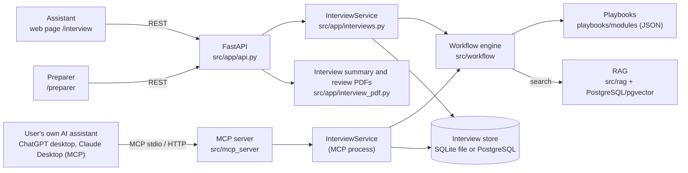

# Architecture

As of 2026-11-18. One backend serves three entry points; every interview is stored once and reviewed by a preparer.

The web server and the MCP server can be separate processes (Claude Desktop starts its own), so they share
interviews through the store, not through memory.

## Components

| Layer | Code | Responsibility | State |
|---|---|---|---|
| Pages | `src/app/static/interview.html` | Assistant runs the interview: topics first, background note, one question at a time, sources, summary PDF | done |
| | `src/app/static/preparer.html` | Preparer: every interview by status (web page and MCP), full review PDF, record, approve / return | done |
| | `src/app/static/index.html` | Rule questions in chat (teammate) | done |
| API | `src/app/api.py` | HTTP for the pages: interviews per browser (start, answer, documents, history, submit), `/api/preparer/...` for review and decisions, summary downloads, chat | done |
| MCP | `src/mcp_server/` | The user's own model drives the interview; our engine keeps control; no API key of ours | done |
| Service | `src/app/interviews.py` | One engine step per call, document facts, interviews saved per owner; `preparer_*` methods read every owner; MCP owner `mcp-assistant` | done |
| Store | `src/db/interview_store.py` | SQLite (default `logs/interviews.sqlite3`) or PostgreSQL; per-owner history; optimistic versioning | done |
| Engine | `src/workflow/` | Next question, answer validation, escalations, reminders, summary | done |
| Playbooks | `playbooks/modules/` | 6 modules, 122 questions, 56 escalation rules, official sources | done; preparer sign-off open |
| Knowledge base | `src/rag/`, `src/db/` | Chunking, embedding, hybrid retrieval (teammates) | 21 documents indexed; Form 8843 Instructions and Pub 519 in progress (`docs/knowledge-base.md`) |
| Model reader | `src/llm/` | Reads free-text answers for the web page (optional, our key) | done |

## Interview life cycle

| Status | Set by | Next |
|---|---|---|
| `in_progress` | `start` | answer questions and submit the completed web interview |
| `waiting_for_preparer` | assistant submission on the web or completion through MCP | preparer approves or returns |
| `approved` / `returned` | preparer on `/preparer` | end (a returned interview is redone as a new one) |

Every answer, client note, background note and decision is kept in `history`: the audit trail the preparer
sees as "Interview record".

## Configuration (.env)

| Variable | Default | Meaning |
|---|---|---|
| `TAX_AGENT_INTERVIEW_DB_PATH` | `logs/interviews.sqlite3` | SQLite file shared by the web and MCP servers |
| `TAX_AGENT_INTERVIEW_DATABASE_URL` | empty | PostgreSQL for interviews instead of SQLite |
| `TAX_AGENT_MCP_TOKEN` | empty | secret path for the MCP tunnel mode (ChatGPT web) |
| `TAX_AGENT_RETRIEVAL` | `on` | `off` = no knowledge base needed |
| `TAX_AGENT_LLM` | `on` | `off` = web page reads exact answers only (MCP always off: the user's model reads) |
| `TAX_AGENT_SUMMARY_DIR` | `interview_summaries/` | extra copy of MCP summaries as files |

For PostgreSQL, the `interviews` table is in `src/db/schema.sql` (the store also creates it if allowed).
Team members' database roles need SELECT, INSERT and UPDATE on it.

## Before any real use (not done; fictional cases only)

| Area | Needed |
|---|---|
| Login and roles | assistant vs preparer accounts; the preparer page and decisions behind preparer login |
| Client data | encryption at rest, retention period, IRC 7216 consent before any disclosure (including to the user's AI provider) |
| MCP over HTTP | authentication before exposing beyond 127.0.0.1 |
| Deployment | container image, managed PostgreSQL, HTTPS, secrets outside `.env` |
| Quality | CI running the tests on every pull request; error logging |
| Playbook versions | record the playbook version used by each interview |

## Timeline

| Date | Target |
|---|---|
| 11/20 | Pipeline complete: interview (web and MCP) → store → preparer review; knowledge base batch 1; document extraction contract |
| 11/23 | System ready: knowledge base batch 2 |
| 11/30 – 12/1 | Final presentation: `docs/demo.md` |
